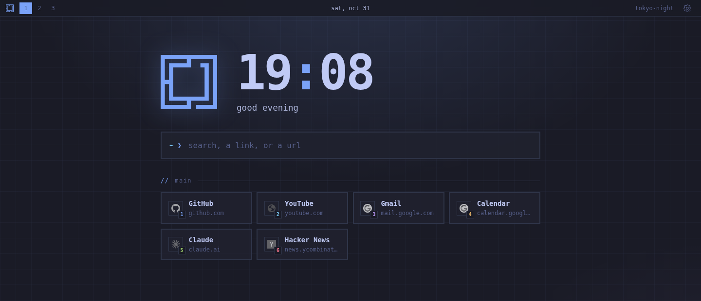

# Omarchy New Tab

[](https://github.com/tcballard/omarchy-badges)

A calm, keyboard-first new tab page for Chrome and Chromium that matches your [Omarchy](https://omarchy.org) theme.



## What you get

- Your Omarchy theme, kept in sync when you switch themes. You can also pick from 11 built-in themes.
- Your Omarchy wallpaper as the background, if you want it.
- A search box that finds your links, open tabs, bookmarks and history as you type.
- Link groups you can open with a single key.

## Install

```bash
git clone https://github.com/FarzadHayat/omarchy-newtab.git
cd omarchy-newtab
bin/install
```

Then open `chrome://extensions`, turn on **Developer mode**, click **Load unpacked** and pick the `omarchy-newtab` folder.

`bin/install` sets things up so the page follows your Omarchy theme and wallpaper. If you move the folder, run it again.

## Using it

- **Just start typing** to search. `Enter` opens the top match. `Shift+Enter` opens it in a new tab.
- **`1` to `9`** open the links on screen.
- **`[` and `]`** switch between link groups.
- **`,`** opens settings. That's where you edit your links, change the theme, and turn on the wallpaper or browser suggestions.

## Good to know

- New tabs start with the cursor in the search box, so the shortcuts work right away. The address bar shows the extension's address; press `Ctrl+L` to type there. Prefer Chrome's address bar? Turn it off in settings.
- Chrome adds a bar at the bottom of new tab pages that come from extensions. To hide it, right-click it and choose **Hide footer on New Tab page**.
- Link icons come from Chrome's own cache. A site you haven't visited yet shows a plain globe until you do.
- A search that starts with a number opens that link instead. To search for something like "1password", click the search box and type a space first.

## Remove it

Run `bin/install --uninstall`, then remove the extension from `chrome://extensions`.

## License

[MIT](LICENSE)
